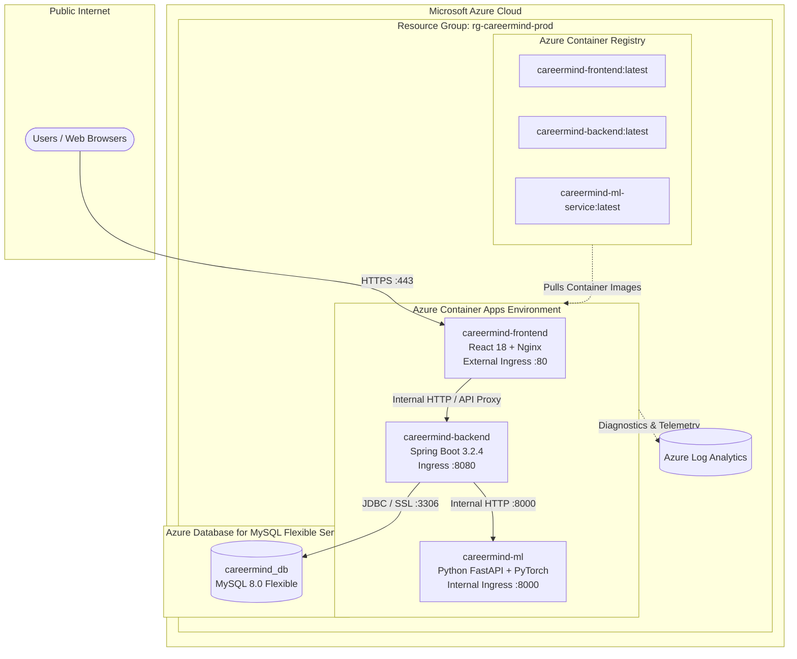

# Deploying CareerMind to Microsoft Azure

This guide explains how to deploy the entire CareerMind AI Resume Intelligence platform (Frontend, Backend, ML Microservice, and MySQL Database) onto **Microsoft Azure** using **Azure Container Apps (ACA)** and **Azure Database for MySQL Flexible Server**.

---

## 1. Architecture Overview on Microsoft Azure



### Why Azure Container Apps (ACA)?
- **Serverless Microservices**: Automatic scaling from 1 to multiple replicas without managing Kubernetes clusters.
- **Cost-Effective**: Pay only for active compute seconds (B1ms MySQL + low baseline Container App CPU).
- **Private Internal Networking**: The Python ML service is strictly internal—it is never exposed to the public internet, ensuring security.
- **Built-in Ingress & Free SSL**: Azure automatically provisions valid HTTPS certificates for the public frontend.

---

## 2. Azure Project File Structure

The project includes ready-to-deploy Azure Infrastructure-as-Code (IaC) and automation scripts:

```
AI powerd resume inteligence/
├── azure/
│   └── bicep/
│       ├── main.bicep               # Root Bicep orchestrator
│       ├── main.parameters.json     # Deployment parameters (region, passwords, etc.)
│       └── modules/
│           ├── acr.bicep            # Azure Container Registry
│           ├── mysql.bicep          # Azure Database for MySQL Flexible Server
│           ├── aca-env.bicep        # ACA Environment & Log Analytics
│           ├── ml-service.bicep     # Container App for FastAPI ML Service
│           ├── backend.bicep        # Container App for Spring Boot Backend
│           └── frontend.bicep       # Container App for React Dashboard
├── scripts/
│   ├── deploy-to-azure.ps1          # One-click Windows PowerShell deployment
│   └── deploy-to-azure.sh           # One-click Bash deployment (Linux/macOS)
├── .github/
│   └── workflows/
│       └── azure-deploy.yml         # Continuous Deployment pipeline via GitHub Actions
├── docker-compose.azure.yml         # Multi-container config for Azure App Service
├── azure.yaml                       # Azure Developer CLI (azd) configuration
└── AZURE_DEPLOYMENT.md              # This deployment documentation
```

---

## 3. Prerequisites

1. An **Active Azure Subscription** ([Free Azure Account](https://azure.microsoft.com/free/)).
2. **Azure CLI (`az`)** installed on your computer:
   - **Windows**: `winget install Microsoft.AzureCLI` or download from [aka.ms/installazurecliwindows](https://aka.ms/installazurecliwindows).
   - **macOS**: `brew install azure-cli`
   - **Linux**: `curl -sL https://aka.ms/InstallAzureCLIDeb | sudo bash`

---

## 4. Option A: One-Click Deployment via PowerShell (Recommended for Windows)

Open PowerShell in the project directory and run:

```powershell
# Navigate to project root
cd "AI powerd resume inteligence"

# Run automated deployment
.\scripts\deploy-to-azure.ps1 -ResourceGroupName "rg-careermind-prod" -Location "eastus" -DbPassword "YourStrongPassword123!"
```

### What this script does automatically:
1. Authenticates your Azure account via `az login`.
2. Creates the Resource Group `rg-careermind-prod`.
3. Sets up an **Azure Container Registry (ACR)**.
4. Uses **ACR Cloud Tasks (`az acr build`)** to build and push all 3 Docker images directly in Azure's cloud infrastructure (no local Docker daemon required!).
5. Deploys the MySQL Flexible database and all Container Apps via **Bicep**.
6. Outputs the live **Frontend URL**, **Backend API**, and **Swagger UI** endpoints.

---

## 5. Option B: Step-by-Step Manual Deployment (Azure CLI)

If you prefer executing step by step:

### Step 1: Login and Set Resource Group
```bash
az login
az group create --name rg-careermind-prod --location eastus
```

### Step 2: Create Azure Container Registry (ACR)
```bash
# Choose an alphanumeric name (e.g. careermindacr1234)
ACR_NAME="careermindacr$(head /dev/urandom | tr -dc a-z0-9 | head -c 6)"

az acr create \
  --resource-group rg-careermind-prod \
  --name $ACR_NAME \
  --sku Basic \
  --admin-enabled true
```

### Step 3: Build Docker Images in Azure Cloud
```bash
az acr build --registry $ACR_NAME --image careermind-ml-service:latest ./ml-service
az acr build --registry $ACR_NAME --image careermind-backend:latest ./backend
az acr build --registry $ACR_NAME --image careermind-frontend:latest ./frontend
```

### Step 4: Deploy Infrastructure with Bicep
```bash
az deployment group create \
  --resource-group rg-careermind-prod \
  --template-file ./azure/bicep/main.bicep \
  --parameters location=eastus \
               prefix=careermind \
               environment=prod \
               dbAdminPassword='YourStrongPassword123!' \
               imageTag=latest
```

Once finished, the terminal outputs the live public URL for your React Frontend.

---

## 6. Option C: CI/CD via GitHub Actions

To automatically redeploy on every `git push`:

1. In Azure, generate credentials for GitHub:
   ```bash
   az ad sp create-for-rbac \
     --name "gh-actions-careermind" \
     --role contributor \
     --scopes /subscriptions/<SUBSCRIPTION_ID>/resourceGroups/rg-careermind-prod \
     --sdk-auth
   ```
2. In your GitHub repository, navigate to **Settings** > **Secrets and variables** > **Actions** and add:
   - `AZURE_CREDENTIALS`: Paste the JSON output from above.
   - `AZURE_MYSQL_PASSWORD`: Your MySQL database password.
   - `JWT_SECRET`: Your 256-bit JWT secret key.
   - `AZURE_RESOURCE_GROUP`: `rg-careermind-prod`.
   - `AZURE_LOCATION`: `eastus`.
3. Whenever you push changes to `main`, `.github/workflows/azure-deploy.yml` will automatically build and roll out the new release.

---

## 7. Useful Operational Commands

| Action | Azure CLI Command |
|---|---|
| **View Live Frontend Logs** | `az containerapp logs show --name careermind-frontend --resource-group rg-careermind-prod --follow` |
| **View Backend Logs** | `az containerapp logs show --name careermind-backend --resource-group rg-careermind-prod --follow` |
| **View ML Service Logs** | `az containerapp logs show --name careermind-ml --resource-group rg-careermind-prod --follow` |
| **Restart Backend** | `az containerapp revision restart --name careermind-backend --resource-group rg-careermind-prod` |
| **Delete All Resources** | `az group delete --name rg-careermind-prod --yes --no-wait` |
