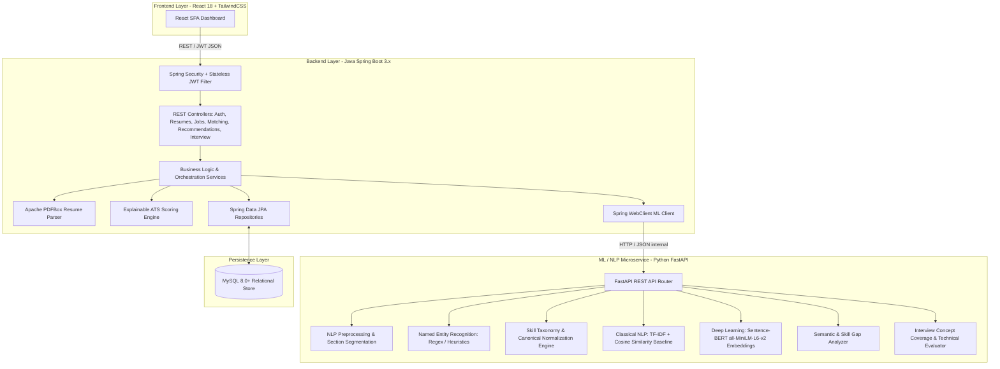
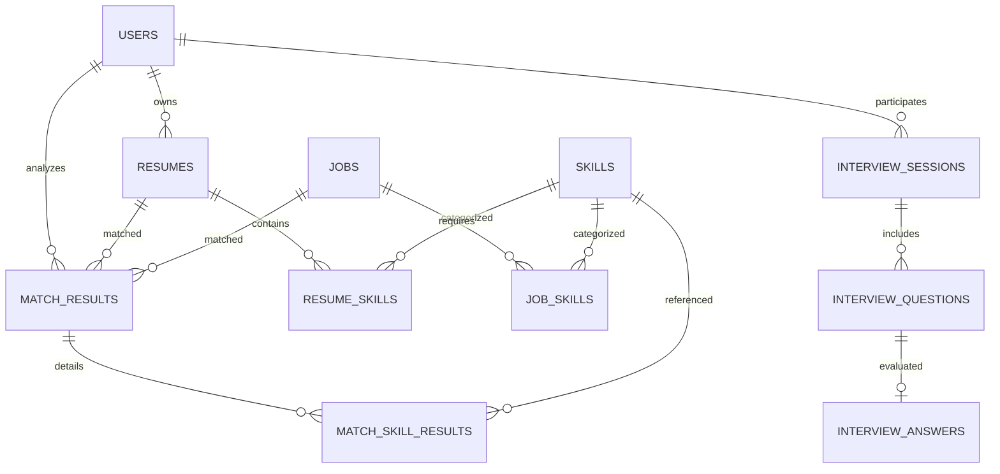

# CareerMind — AI Resume Intelligence & Job Matching Platform

[](https://openjdk.org/)
[](https://spring.io/projects/spring-boot)
[](https://python.org/)
[](https://fastapi.tiangolo.com/)
[](https://react.dev/)
[](https://www.docker.com/)

CareerMind is a full-stack, enterprise-grade AI Resume Intelligence and Job Matching platform. It demonstrates professional software architecture combining **Java Spring Boot 3.x**, a **Python FastAPI NLP/Deep Learning microservice**, **MySQL 8+**, and a modern **React 18 Dashboard**.

The platform extracts structured information from candidate PDF resumes, normalizes technical skills against a comprehensive canonical taxonomy, performs semantic comparison with Job Descriptions using transformer sentence embeddings, computes an explainable 6-factor ATS score, detects skill gaps, ranks job recommendations, and evaluates candidate technical interview answers along multi-dimensional semantic criteria.

---

## 1. System Architecture



### Architectural Principles
- **Separation of Concerns**: The Java Spring Boot backend manages orchestration, database persistence, security, and transactions. The Python FastAPI microservice is dedicated exclusively to NLP, dense embeddings, and DL inference.
- **Model Lifecycle**: Transformer models are pre-warmed once at FastAPI startup and kept in memory for low-latency inference.
- **Resilience**: Communication via Spring `WebClient` includes configured timeouts and graceful degradation with structured `MlServiceException` handling.

---

## 2. Technology Stack

| Layer | Technologies |
|---|---|
| **Backend** | Java 17 LTS, Spring Boot 3.2.4, Spring Security 6, Spring Data JPA, Hibernate, JWT (`jjwt`), Apache PDFBox, Spring WebFlux (`WebClient`), Lombok, SpringDoc OpenAPI 3 (Swagger UI), JUnit 5, Mockito |
| **ML / NLP Service** | Python 3.10+, FastAPI, Uvicorn, PyTorch, Sentence-Transformers (`all-MiniLM-L6-v2`), spaCy, scikit-learn, NumPy, pandas, Pydantic v2, Pytest |
| **Frontend** | React 18, Vite, JavaScript (ES6+), Tailwind CSS, Lucide Icons, Axios, Chart.js / react-chartjs-2, React Router v6 |
| **Database** | MySQL 8.0+ (with H2 in-memory profile for rapid integration testing) |
| **DevOps & Containers** | Docker, Docker Compose, Multi-stage builds, Nginx |

---

## 3. Database Schema (Normalized MySQL 8+)



### Key Entities
- `users`: User credentials with BCrypt hashing and roles (`ROLE_USER`, `ROLE_ADMIN`).
- `resumes`: PDF metadata, extracted text, parsed section JSON, and NER candidate details.
- `skills`: Canonical skill dictionary with category taxonomy (Backend, Frontend, Cloud, DevOps, Deep Learning, etc.).
- `resume_skills`: Extracted candidate skills with confidence metrics and context snippets.
- `jobs`: Job posting details, requirements, experience tenure, and required skills.
- `job_skills`: Job requirements tagged with `is_required` flag and importance weights.
- `match_results`: Stored 6-factor explainable ATS scores, baseline TF-IDF score, and explanation JSON.
- `match_skill_results`: Breakdown of exact matched, partial (affinity), and missing skills.
- `interview_sessions`, `interview_questions`, `interview_answers`: AI interview simulation questions, answers, and 4-factor scoring criteria.

---

## 4. Explainable ATS Scoring Engine

CareerMind implements an explainable, deterministic ATS scoring formula:

$$\text{ATS Score} = 0.30 \times \text{SkillScore} + 0.30 \times \text{SemanticScore} + 0.15 \times \text{ExperienceScore} + 0.10 \times \text{EducationScore} + 0.10 \times \text{KeywordScore} + 0.05 \times \text{QualityScore}$$

### Factor Descriptions
1. **Skill Match (30%)**: Weighted coverage of required and preferred skills. Matches include exact canonical hits and partial affinity mappings (e.g. PostgreSQL mapped to MySQL).
2. **Semantic Fit (30%)**: Cosine similarity of 384-dimensional dense vectors generated by the `all-MiniLM-L6-v2` transformer model.
3. **Experience Match (15%)**: Extracted candidate tenure vs job requirements.
4. **Education Match (10%)**: Level alignment (Doctorate > Master's > Bachelor's > Associate).
5. **Keyword / TF-IDF (10%)**: Classical n-gram term frequencies and inverse document frequencies.
6. **Resume Quality (5%)**: Action-verb density, quantifiable metrics presence, and structured section completeness.

---

## 5. Classical NLP Baseline vs Deep Learning Embeddings

To demonstrate real NLP progression, the platform implements both:

1. **Classical NLP Baseline**: `TfidfVectorizer` (sublinear TF, n-grams 1-2, English stop words) + Cosine Similarity.
2. **Deep Learning Transformer**: `all-MiniLM-L6-v2` Sentence-BERT dense vector embeddings + Cosine Similarity.

### Empirical Benchmark Evaluation Results

Running `python -m app.evaluation.benchmark` on the labeled evaluation dataset:

| Metric | Classical TF-IDF Baseline | Sentence-BERT Transformer |
|---|---|---|
| **Mean Absolute Error (MAE)** | **60.32 pts** | **43.85 pts** (Lower error) |
| **Pearson Correlation ($r$)** | **0.883** | **0.656** |

---

## 6. AI Interview Simulator & Evaluation

### Question Generation
Questions are dynamically generated across technical domains tailored to candidate matched strengths and missing gaps:
- **Java / JVM Memory Model & Generational Garbage Collection**
- **Spring Boot / Spring Security Filter Chain & Stateless JWT**
- **Distributed Microservices & Saga Pattern vs 2PC**
- **Database Indexing & Resolving Hibernate N+1 Select Problems**
- **High-Scale Vector Search & System Design**
- **STAR-Method Behavioral Engineering Leadership**

### Answer Evaluation Dimensions
- **Relevance Score (40%)**: Semantic closeness to ideal reference architecture.
- **Concept Coverage Score (40%)**: Identification and explanation of required technical concepts.
- **Completeness Score (20%)**: Technical depth, term density, and clarity.
- **Actionable AI Feedback**: Specific missing concept highlights.

---

## 7. REST API Documentation

### Authentication (`/api/auth`)
- `POST /api/auth/register` — Register new user account.
- `POST /api/auth/login` — Authenticate and receive JWT bearer token.
- `GET /api/auth/me` — Get current authenticated user profile.

### Resumes (`/api/resumes`)
- `POST /api/resumes/upload` — Multipart PDF upload, Apache PDFBox text extraction & NLP parsing.
- `GET /api/resumes` — List active resumes owned by the current user.
- `GET /api/resumes?archived=true` — List the current user's archived resumes.
- `GET /api/resumes/{id}` — Get detailed resume and extracted skills.
- `POST /api/resumes/{id}/archive` — Remove a resume from the active list while preserving history.
- `POST /api/resumes/{id}/restore` — Return an archived resume to the active list.
- `DELETE /api/resumes/{id}` — Permanently delete a resume only when no interview or matching history references it; otherwise returns `409 Conflict`.

For an existing MySQL database, apply `database/migrations/V2__archive_resumes.sql` once before deploying this version. Fresh databases should use the updated `database/schema.sql`.

### Jobs (`/api/jobs`)
- `POST /api/jobs` — Create job posting with manual or auto-extracted skills.
- `GET /api/jobs` — List all active job postings.
- `GET /api/jobs/{id}` — Get job posting details and requirements.
- `DELETE /api/jobs/{id}` — Delete job posting.

### Matching & ATS Scoring (`/api/matching`)
- `POST /api/matching/analyze` — Run explainable ATS analysis between resume and job.
- `GET /api/matching/{id}` — Retrieve historical match result and breakdown.

### Recommendations (`/api/recommendations`)
- `GET /api/recommendations?resumeId={id}` — Retrieve jobs ranked by $0.60 \times \text{Semantic} + 0.40 \times \text{Skill}$.

### Interview Simulator (`/api/interview`)
- `POST /api/interview/sessions` — Start tailored interview prep session.
- `GET /api/interview/sessions` — List user's interview sessions.
- `GET /api/interview/sessions/{id}` — Get session details and questions.
- `POST /api/interview/questions/{id}/answer` — Submit answer for 4-factor AI evaluation.

---

## 8. Running Locally

### Prerequisites
- **Java 17+**
- **Maven 3.9+**
- **Python 3.10+**
- **Node.js 18+** & **npm**
- **MySQL 8.0+** (or use Docker Compose)

### 1. Start Python ML Microservice
```bash
cd ml-service
python -m venv venv
# Windows:
.\venv\Scripts\activate
# Linux/macOS:
source venv/bin/activate

pip install -r requirements.txt
python -m uvicorn app.main:app --host 0.0.0.0 --port 8000 --reload
```

### 2. Start Java Spring Boot Backend
```bash
cd backend
mvn clean spring-boot:run
```
Swagger UI documentation is accessible at: `http://localhost:8080/swagger-ui.html`

### 3. Start React Frontend
```bash
cd frontend
npm install
npm run dev
```
Access the web dashboard at `http://localhost:3000`.

---

## 9. Running with Docker Compose

To launch all 4 microservice containers (MySQL, FastAPI, Spring Boot, React/Nginx):

```bash
docker compose up --build
```

- **Frontend Dashboard**: `http://localhost:3000`
- **Spring Boot API**: `http://localhost:8080`
- **Swagger Documentation**: `http://localhost:8080/swagger-ui.html`
- **FastAPI ML Service**: `http://localhost:8000/docs`
- **MySQL Store**: `localhost:3306`

---

## 10. Automated Tests

### Backend Unit & Integration Tests (JUnit 5 & Mockito)
```bash
cd backend
mvn clean test
```

### Python ML Tests (Pytest)
```bash
cd ml-service
pytest tests/
```

### ML Empirical Evaluation Benchmark
```bash
cd ml-service
python -m app.evaluation.benchmark
```
